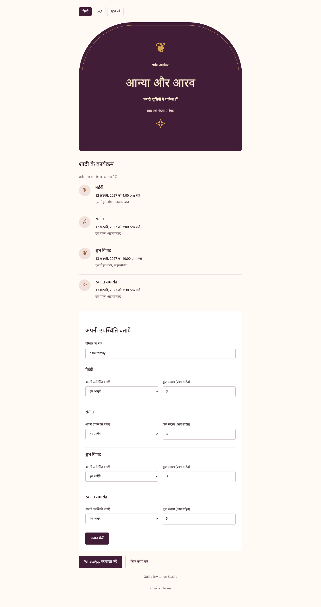
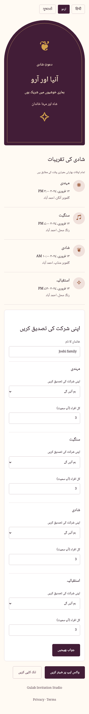
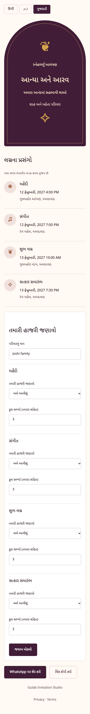
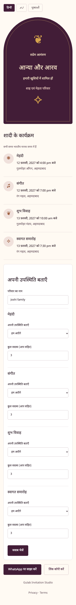
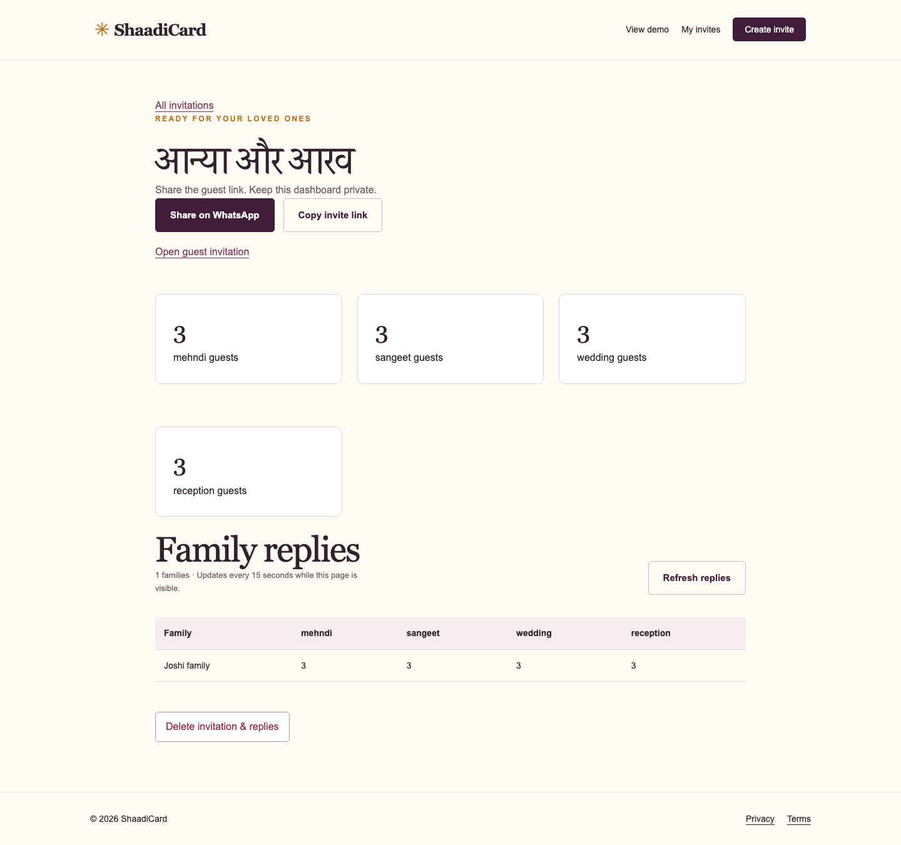
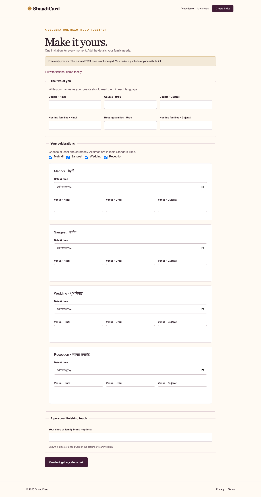
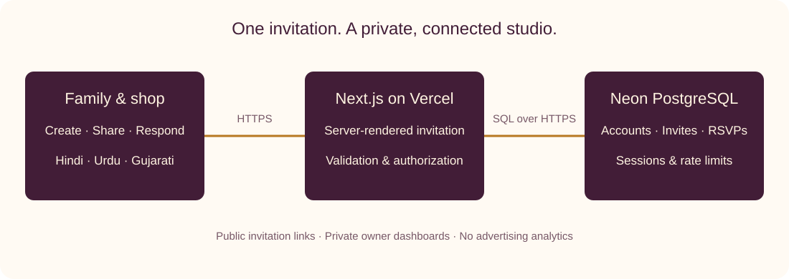

<p align="center"></p>
<p align="center">A wedding invitation that speaks your family's language.</p>
<p align="center"><a href="package.json"></a> <a href="LICENSE"></a> <a href="package.json"></a> <a href="https://shaadicard-taupe.vercel.app"></a></p>

<p align="center"><a href="https://shaadicard-taupe.vercel.app">Explore ShaadiCard</a> · <a href="https://shaadicard-taupe.vercel.app/i/aanya-and-aarav">Open the fictional family invitation</a></p>

**Release status:** the public site is a demo. Full creation and persistent RSVP work locally against the dedicated Neon database, but automatic approval review blocked uploading its credential to Vercel. Hosted saving awaits that approval. Payments are disabled; ₹999 is the planned price, not a charge. See [activation steps](docs/RELEASE.md).

## The problem

“Which family is coming to which ceremony?” is the planning question this product addresses, not a customer quotation. A wedding can have four ceremonies, relatives reading different scripts, and a host trying to turn scattered replies into a catering count. An invitation shop can make the card beautiful and still leave the family with that coordination work.

## How we felt it

The brief described a familiar handoff: a shop prepares the card, the family forwards it on WhatsApp, and someone separately records attendance. We used that workflow as the design starting point. We have not interviewed families or claimed personal wedding-planning experience. [Research and the cheapest validation test](PLAN.md) distinguish published competitor facts from our assumptions.

## What we built

### Every ceremony, one link

Mehndi, sangeet, wedding and reception each have their own date, time and venue. A single ornamental invitation keeps the focus on the celebration. Server-rendered metadata and generated OG images support rich link previews; actual WhatsApp cache behavior still needs a phone check.



### Three languages, with room to breathe

The creator enters family names and venues in Hindi, Urdu and Gujarati. Guests switch languages without leaving the invite. Self-hosted fonts and Urdu RTL support keep the reading experience coherent. There is no unreviewed automatic translation service.

<p>  </p>

### Family replies for each celebration

A guest chooses attendance and family size separately for each ceremony. The same browser can update its answer without duplicating the family. Hosts see private headcounts, refreshed every 15 seconds. Names are not proof of identity; changing browsers creates a separate response.



### Your shop, their special day

Invite shops can add their name to each customer invitation. Branded guest pages omit ShaadiCard's platform header and footer. Platform account and legal pages retain their own identity. Custom domains and uploaded logos are outside this version.



## How it works



Next.js renders invitation details and preview metadata on the server.  
Neon PostgreSQL stores accounts, invitations, family replies and rate-limit buckets.  
Opaque, hashed session tokens protect host dashboards; every owner query is scoped.  
Validated RSVP writes upsert by invitation and guest-cookie hash.  
Vercel hosts the public demo; enabling its runtime database secret unlocks persistence.

## Quickstart

Requires Node 22.13+ and npm. From a clone of this repository, four commands start a local-only PostgreSQL-compatible development database with PGlite:

```sh
npm ci
printf 'LOCAL_DATABASE=1\nAPP_URL=http://127.0.0.1:3024\n' > .env.local
npm run db:migrate && npm run build
npm run start
```

Open [the local app](http://127.0.0.1:3024). On an existing configured checkout, preserve `.env.local` instead of overwriting it. For Neon, use the pooled `DATABASE_URL` for runtime and `DATABASE_URL_UNPOOLED` for migrations. No credentials belong in Git. The local fallback is explicitly disabled on Vercel. [Production setup and operations](docs/RELEASE.md).

## Screenshots

Real Playwright captures of this production build, with fictional family/test-account data. Desktop: 1440×1000. Mobile: 390×844. The screenshot test starts the production server if one is not already running.


[Mobile homepage](docs/screenshots/home-mobile.png) · [Private invitation list](docs/screenshots/dashboard-desktop.png) · [Phone editor](docs/screenshots/editor-mobile.png) · [404](docs/screenshots/404-mobile.png)

Regenerate with `npm run build && npm run shots`. The reusable [shots.spec.ts](tests/shots.spec.ts) covers every main route at both sizes. No mock UI was composited into these screenshots.

## Demo video

[](docs/demo.mp4)

[Watch/download the 62-second MP4](docs/demo.mp4). A real browser creates a shop-branded invitation, switches languages, submits a family RSVP and shows the resulting host headcount. It includes system-generated voice narration and large captions. The recording uses local production code connected to Neon; it is not evidence that hosted persistence is enabled.

[Storyline](docs/demo-story.md) · [Narration](docs/narration.txt) · [Recording script](scripts/record-demo.mjs) · [Caption/render script](scripts/caption-demo.mjs)

## Why this is interesting

- **Three complete scripts, one constrained design.** Creator-supplied translations avoid silently mistranslating family names. The trade-off is entering the details three times.
- **An idempotent family reply without a guest account.** A private guest cookie enables correction; it also means another browser can create another response. We do not claim identity verification.
- **A small, auditable server boundary.** Owner-scoped queries, shared Postgres rate limits, restricted runtime permissions and per-response CSP nonces reduce accidental exposure. Polling every 15 seconds is simpler than sockets, at the cost of delayed updates and database reads.

## Validation and launch evidence

See [the security review](docs/SECURITY.md) and [release evidence](docs/GATES.md) for exact results and limitations. Commands: `npm test`, `npm run typecheck`, `npm run lint`, `npm run test:e2e`. Launch scripts run unmodified from the shared `../launch-kit`.

The week-one targets are **30 real invitations**, **10 verified paid invitations**, and **60% of invitations with a reply**. These are targets, not traction. [Metric queries](scripts/metrics.sql) exclude test accounts. No paid outcome is inferred from free use.

[Launch drafts](LAUNCH.md) · [Decisions](DECISIONS.md) · [Source notice](LICENSE)
